<!-- GENERIERT - nicht editieren. Erzeugt von tools/build.py aus src/forge. -->

# dv-forge: Aufrufgraph

```mermaid
flowchart LR
  Etappe_abschluss(["Etappe abschluss"]) --> finish_work["finish-work<br/><small>skill · intern</small>"]
  Etappe_grill(["Etappe grill"]) --> spec_grilling["spec-grilling<br/><small>skill · intern</small>"]
  Etappe_plan_review(["Etappe plan-review"]) --> plan_review["plan-review<br/><small>skill · intern</small>"]
  Etappe_planning(["Etappe planning"]) --> plan_orchestrator["plan-orchestrator<br/><small>skill · intern</small>"]
  Etappe_spec_review(["Etappe spec-review"]) --> spec_review_orchestrator["spec-review-orchestrator<br/><small>skill · intern</small>"]
  Etappe_umsetzung(["Etappe umsetzung"]) --> implementation_orchestrator["implementation-orchestrator<br/><small>skill · intern</small>"]
  Etappe_whiteboarding(["Etappe whiteboarding"]) --> spec_whiteboarding_with_docs["spec-whiteboarding-with-docs<br/><small>skill · intern</small>"]
  implementation["implementation<br/><small>skill · intern</small>"] --> implementation_final_reviewer[["implementation-final-reviewer<br/><small>agent · final-reviewer</small>"]]
  implementation["implementation<br/><small>skill · intern</small>"] --> implementation_implementer[["implementation-implementer<br/><small>agent · implementer</small>"]]
  implementation["implementation<br/><small>skill · intern</small>"] --> implementation_re_reviewer[["implementation-re-reviewer<br/><small>agent · re-reviewer</small>"]]
  implementation["implementation<br/><small>skill · intern</small>"] --> implementation_task_reviewer[["implementation-task-reviewer<br/><small>agent · task-reviewer</small>"]]
  implementation_orchestrator["implementation-orchestrator<br/><small>skill · intern</small>"] --> implementation["implementation<br/><small>skill · intern</small>"]
  implementation_orchestrator["implementation-orchestrator<br/><small>skill · intern</small>"] --> implementation_review["implementation-review<br/><small>skill · intern</small>"]
  implementation_orchestrator["implementation-orchestrator<br/><small>skill · intern</small>"] --> review_followup["review-followup<br/><small>skill · intern</small>"]
  implementation_orchestrator["implementation-orchestrator<br/><small>skill · intern</small>"] --> start_work["start-work<br/><small>skill · intern</small>"]
  implementation_review["implementation-review<br/><small>skill · intern</small>"] --> implementation_review_acceptance[["implementation-review-acceptance<br/><small>agent · reviewer</small>"]]
  implementation_review["implementation-review<br/><small>skill · intern</small>"] --> implementation_review_design[["implementation-review-design<br/><small>agent · reviewer</small>"]]
  implementation_review["implementation-review<br/><small>skill · intern</small>"] --> implementation_review_plan_fidelity[["implementation-review-plan-fidelity<br/><small>agent · reviewer</small>"]]
  implementation_review["implementation-review<br/><small>skill · intern</small>"] --> implementation_review_risks[["implementation-review-risks<br/><small>agent · reviewer</small>"]]
  implementation_review["implementation-review<br/><small>skill · intern</small>"] --> implementation_review_scout[["implementation-review-scout<br/><small>agent · scout</small>"]]
  implementation_review["implementation-review<br/><small>skill · intern</small>"] --> implementation_review_tests[["implementation-review-tests<br/><small>agent · reviewer</small>"]]
  init["init<br/><small>skill · werkzeug</small>"] --> commit_message["commit-message<br/><small>skill · werkzeug</small>"]
  plan_orchestrator["plan-orchestrator<br/><small>skill · intern</small>"] --> plan_review["plan-review<br/><small>skill · intern</small>"]
  plan_orchestrator["plan-orchestrator<br/><small>skill · intern</small>"] --> plan_writing["plan-writing<br/><small>skill · intern</small>"]
  plan_orchestrator["plan-orchestrator<br/><small>skill · intern</small>"] --> review_followup["review-followup<br/><small>skill · intern</small>"]
  plan_review["plan-review<br/><small>skill · intern</small>"] --> plan_review_architecture[["plan-review-architecture<br/><small>agent · reviewer</small>"]]
  plan_review["plan-review<br/><small>skill · intern</small>"] --> plan_review_buildability[["plan-review-buildability<br/><small>agent · reviewer</small>"]]
  plan_review["plan-review<br/><small>skill · intern</small>"] --> plan_review_coverage[["plan-review-coverage<br/><small>agent · reviewer</small>"]]
  plan_review["plan-review<br/><small>skill · intern</small>"] --> plan_review_feasibility[["plan-review-feasibility<br/><small>agent · reviewer</small>"]]
  plan_review["plan-review<br/><small>skill · intern</small>"] --> plan_review_risks[["plan-review-risks<br/><small>agent · reviewer</small>"]]
  plan_review["plan-review<br/><small>skill · intern</small>"] --> plan_review_scout[["plan-review-scout<br/><small>agent · scout</small>"]]
  plan_review["plan-review<br/><small>skill · intern</small>"] --> plan_review_verifier[["plan-review-verifier<br/><small>agent · verifier</small>"]]
  plan_review["plan-review<br/><small>skill · intern</small>"] --> plan_rework[["plan-rework<br/><small>agent · rework</small>"]]
  plan_writing["plan-writing<br/><small>skill · intern</small>"] --> implementation["implementation<br/><small>skill · intern</small>"]
  plan_writing["plan-writing<br/><small>skill · intern</small>"] --> review_followup["review-followup<br/><small>skill · intern</small>"]
  review_followup["review-followup<br/><small>skill · intern</small>"] --> implementation_implementer[["implementation-implementer<br/><small>agent · implementer</small>"]]
  review_followup["review-followup<br/><small>skill · intern</small>"] --> implementation_re_reviewer[["implementation-re-reviewer<br/><small>agent · re-reviewer</small>"]]
  session_orchestrator["session-orchestrator<br/><small>skill · startbefehl</small>"] --> Etappe_abschluss(["Etappe abschluss"])
  session_orchestrator["session-orchestrator<br/><small>skill · startbefehl</small>"] --> Etappe_grill(["Etappe grill"])
  session_orchestrator["session-orchestrator<br/><small>skill · startbefehl</small>"] --> Etappe_plan_nacharbeit(["Etappe plan-nacharbeit"])
  session_orchestrator["session-orchestrator<br/><small>skill · startbefehl</small>"] --> Etappe_plan_review(["Etappe plan-review"])
  session_orchestrator["session-orchestrator<br/><small>skill · startbefehl</small>"] --> Etappe_planning(["Etappe planning"])
  session_orchestrator["session-orchestrator<br/><small>skill · startbefehl</small>"] --> Etappe_spec_nacharbeit(["Etappe spec-nacharbeit"])
  session_orchestrator["session-orchestrator<br/><small>skill · startbefehl</small>"] --> Etappe_spec_review(["Etappe spec-review"])
  session_orchestrator["session-orchestrator<br/><small>skill · startbefehl</small>"] --> Etappe_umsetzung(["Etappe umsetzung"])
  session_orchestrator["session-orchestrator<br/><small>skill · startbefehl</small>"] --> Etappe_whiteboarding(["Etappe whiteboarding"])
  spec_review["spec-review<br/><small>skill · intern</small>"] --> spec_review_clarity[["spec-review-clarity<br/><small>agent · reviewer</small>"]]
  spec_review["spec-review<br/><small>skill · intern</small>"] --> spec_review_completeness[["spec-review-completeness<br/><small>agent · reviewer</small>"]]
  spec_review["spec-review<br/><small>skill · intern</small>"] --> spec_review_consistency[["spec-review-consistency<br/><small>agent · reviewer</small>"]]
  spec_review["spec-review<br/><small>skill · intern</small>"] --> spec_review_feasibility[["spec-review-feasibility<br/><small>agent · reviewer</small>"]]
  spec_review["spec-review<br/><small>skill · intern</small>"] --> spec_review_profiles[["spec-review-profiles<br/><small>agent · reviewer</small>"]]
  spec_review["spec-review<br/><small>skill · intern</small>"] --> spec_review_scout[["spec-review-scout<br/><small>agent · scout</small>"]]
  spec_review["spec-review<br/><small>skill · intern</small>"] --> spec_review_verifier[["spec-review-verifier<br/><small>agent · verifier</small>"]]
  spec_review["spec-review<br/><small>skill · intern</small>"] --> spec_rework[["spec-rework<br/><small>agent · rework</small>"]]
  spec_review_orchestrator["spec-review-orchestrator<br/><small>skill · intern</small>"] --> review_followup["review-followup<br/><small>skill · intern</small>"]
  spec_review_orchestrator["spec-review-orchestrator<br/><small>skill · intern</small>"] --> spec_review["spec-review<br/><small>skill · intern</small>"]
  spec_whiteboarding["spec-whiteboarding<br/><small>skill · intern</small>"] --> review_followup["review-followup<br/><small>skill · intern</small>"]
  spec_whiteboarding["spec-whiteboarding<br/><small>skill · intern</small>"] --> spec_whiteboarding_with_docs["spec-whiteboarding-with-docs<br/><small>skill · intern</small>"]
  spec_whiteboarding_with_docs["spec-whiteboarding-with-docs<br/><small>skill · intern</small>"] --> domain_modeling["domain-modeling<br/><small>skill · werkzeug</small>"]
  spec_whiteboarding_with_docs["spec-whiteboarding-with-docs<br/><small>skill · intern</small>"] --> spec_whiteboarding["spec-whiteboarding<br/><small>skill · intern</small>"]
```

Kanten entstehen aus den Verweisen `dv-forge:<name>` im Text und aus `etappen.yaml`. Der Build bricht ab, wenn ein Verweis auf keinen Skill oder Agent zeigt.

| Komponente | Art | Rolle/Typ | verweist auf |
|---|---|---|---|
| `commit-message` | skill | werkzeug | – |
| `domain-modeling` | skill | werkzeug | – |
| `finish-work` | skill | intern | – |
| `implementation` | skill | intern | `implementation-final-reviewer`, `implementation-implementer`, `implementation-re-reviewer`, `implementation-task-reviewer` |
| `implementation-final-reviewer` | agent | final-reviewer | – |
| `implementation-implementer` | agent | implementer | – |
| `implementation-orchestrator` | skill | intern | `implementation`, `implementation-review`, `review-followup`, `start-work` |
| `implementation-re-reviewer` | agent | re-reviewer | – |
| `implementation-review` | skill | intern | `implementation-review-acceptance`, `implementation-review-design`, `implementation-review-plan-fidelity`, `implementation-review-risks`, `implementation-review-scout`, `implementation-review-tests` |
| `implementation-review-acceptance` | agent | reviewer | – |
| `implementation-review-design` | agent | reviewer | – |
| `implementation-review-plan-fidelity` | agent | reviewer | – |
| `implementation-review-risks` | agent | reviewer | – |
| `implementation-review-scout` | agent | scout | – |
| `implementation-review-tests` | agent | reviewer | – |
| `implementation-task-reviewer` | agent | task-reviewer | – |
| `init` | skill | werkzeug | `commit-message` |
| `merge-conflict-resolution` | skill | werkzeug | – |
| `plan-orchestrator` | skill | intern | `plan-review`, `plan-writing`, `review-followup` |
| `plan-review` | skill | intern | `plan-review-architecture`, `plan-review-buildability`, `plan-review-coverage`, `plan-review-feasibility`, `plan-review-risks`, `plan-review-scout`, `plan-review-verifier`, `plan-rework` |
| `plan-review-architecture` | agent | reviewer | – |
| `plan-review-buildability` | agent | reviewer | – |
| `plan-review-coverage` | agent | reviewer | – |
| `plan-review-feasibility` | agent | reviewer | – |
| `plan-review-risks` | agent | reviewer | – |
| `plan-review-scout` | agent | scout | – |
| `plan-review-verifier` | agent | verifier | – |
| `plan-rework` | agent | rework | – |
| `plan-writing` | skill | intern | `implementation`, `review-followup` |
| `review-followup` | skill | intern | `implementation-implementer`, `implementation-re-reviewer` |
| `session-orchestrator` | skill | startbefehl | `Etappe abschluss`, `Etappe grill`, `Etappe plan-nacharbeit`, `Etappe plan-review`, `Etappe planning`, `Etappe spec-nacharbeit`, `Etappe spec-review`, `Etappe umsetzung`, `Etappe whiteboarding` |
| `spec-grilling` | skill | intern | – |
| `spec-review` | skill | intern | `spec-review-clarity`, `spec-review-completeness`, `spec-review-consistency`, `spec-review-feasibility`, `spec-review-profiles`, `spec-review-scout`, `spec-review-verifier`, `spec-rework` |
| `spec-review-clarity` | agent | reviewer | – |
| `spec-review-completeness` | agent | reviewer | – |
| `spec-review-consistency` | agent | reviewer | – |
| `spec-review-feasibility` | agent | reviewer | – |
| `spec-review-orchestrator` | skill | intern | `review-followup`, `spec-review` |
| `spec-review-profiles` | agent | reviewer | – |
| `spec-review-scout` | agent | scout | – |
| `spec-review-verifier` | agent | verifier | – |
| `spec-rework` | agent | rework | – |
| `spec-whiteboarding` | skill | intern | `review-followup`, `spec-whiteboarding-with-docs` |
| `spec-whiteboarding-with-docs` | skill | intern | `domain-modeling`, `spec-whiteboarding` |
| `start-work` | skill | intern | – |

Nicht aufgerufen (weder Startbefehl noch Werkzeug): keine.
